# TECHNICAL ARCHITECTURE: HỆ THỐNG EMS BANQUET WEB & ANALYTICS

> **TÀI LIỆU ĐẶC TẢ KIẾN TRÚC KỸ THUẬT VÀ HẠ TẦNG VẬN HÀNH**

---

## 1. TỔNG QUAN KIẾN TRÚC HỆ THỐNG

Hệ thống được thiết kế theo kiến trúc **Client - Server hiện đại** kết hợp mô hình phân tách 2 phân hệ chuyên biệt:
1. **EMS Banquet Web (Cổng 8090)**: Phân hệ lõi phục vụ tác nghiệp hàng ngày (Lịch sảnh, đơn tiệc, BEO, quản lý danh mục, nhật ký audit).
2. **EMS Banquet Analytics (Cổng 8088)**: Phân hệ báo cáo thống kê và phân tích kinh doanh đa chiều phục vụ ban giám đốc.

```mermaid
graph TB
    subgraph ClientTier["Tầng Giao Diện (Client / Web Browser)"]
        SPA_Web["EMS Banquet Web SPA\n(HTML5 / TailwindCSS / Vanilla JS)"]
        SPA_Ana["EMS Analytics SPA\n(HTML5 / TailwindCSS / Chart.js)"]
    end

    subgraph ServerTier["Tầng Máy Chủ Ứng Dụng (10.17.10.12)"]
        subgraph Svc1["Windows Service: EMS_Banquet_Web (Port 8090)"]
            FastAPI_Web["FastAPI Core App"]
            AuthMod["Authentication & Session Module"]
            SchedMod["Scheduler & Conflict Resolver"]
            BeoMod["BEO & Print Generator"]
            ItemsMod["Dynamic Items CRUD Engine"]
            AuditMod["Audit Trail Logger"]
        end

        subgraph Svc2["Windows Service: EMS_Banquet_Analytics (Port 8088)"]
            FastAPI_Ana["FastAPI Analytics App"]
            StatEngine["Revenue & Segment Aggregator"]
            ReportGen["Report Export Engine"]
        end

        subgraph Svc3["Windows Service: EMS_Banquet_AI (Port 8092)"]
            FastAPI_AI["FastAPI AI Coding Agent"]
            AuthAI["Master Password Gateway"]
            DiffEngine["Side-by-side Diff Engine"]
            ASTCheck["AST Syntax Validator"]
            SnapshotMgr["Double Snapshot & 1-Click Rollback"]
        end
    end

    subgraph DataTier["Tầng Dữ Liệu"]
        MSSQL[("Microsoft SQL Server 2016\nDatabase: EMS_KHAIVY\n(Bảng tiệc, sảnh, khách, giá, users)")]
        SQLite[("SQLite 3 Database\nFile: data/audit.db\n(Lưu lịch sử thao tác)")]
        Snapshots[("Snapshot Storage\nDirectory: .ai_snapshots/\n(Bản sao lưu code tự động)")]
    end

    SPA_Web -->|REST API :8090| FastAPI_Web
    SPA_Ana -->|REST API :8088| FastAPI_Ana
    SPA_AI["EMS AI Coding Agent SPA\n(HTML5 / Dark Theme / Fira Code)"] -->|REST API :8092| FastAPI_AI

    FastAPI_Web -->|pyodbc Driver| MSSQL
    FastAPI_Web -->|sqlite3 connection| SQLite
    FastAPI_Ana -->|pyodbc Driver| MSSQL
    FastAPI_AI -->|Snapshot Backup & Rollback| Snapshots
```



---

## 2. PHÂN HỆ BACKEND (PYTHON / FASTAPI)

### 2.1. Cấu hình Dịch vụ & Mạng
* **Dịch vụ EMS Banquet Web**:
  * Thư mục mã nguồn: `d:\DATTIEC\ems-web\`
  * File khởi chạy: `app.py`
  * Cổng lắng nghe: `8090` (Binding: `0.0.0.0:8090`)
  * Trạng thái Windows Service: `EMS_Banquet_Web` (quản lý bởi NSSM)
* **Dịch vụ EMS Banquet Analytics**:
  * Thư mục mã nguồn: `d:\DATTIEC\ems-analytics\`
  * File khởi chạy: `app.py`
  * Cổng lắng nghe: `8088` (Binding: `0.0.0.0:8088`)
  * Trạng thái Windows Service: `EMS_Banquet_Analytics` (quản lý bởi NSSM)
* **Dịch vụ EMS Banquet AI Coding Agent**:
  * Thư mục mã nguồn: `d:\DATTIEC\ems-ai\`
  * File khởi chạy: `app.py` & `ai_coder_engine.py`
  * Cổng lắng nghe: `8092` (Binding: `0.0.0.0:8092`)
  * Trạng thái Windows Service: `EMS_Banquet_AI` (quản lý bởi NSSM)

### 2.2. Kết nối Cơ sở dữ liệu SQL Server
Chuỗi kết nối chuẩn trong `app.py`:
```python
DEFAULT_SERVER = "localhost\MSSQLSERVER2016" if os.path.exists(r"D:\EMSMDH") else "10.17.10.12\MSSQLSERVER2016"
SQL_SERVER = os.getenv("EMS_SQL_SERVER", DEFAULT_SERVER)

CONN_STR = (
    "DRIVER={SQL Server};"
    f"SERVER={SQL_SERVER};"
    "DATABASE=EMS_KHAIVY;"
    "UID=SA;"
    "PWD=Sa!123123#;"
)
```
* **Connection Pooling & Safety**: Hàm helper `get_db_cursor()` tự động tạo cursor kết nối, xử lý timeout và giải phóng tài nguyên qua `try ... finally`.

### 2.3. Cơ sở dữ liệu Audit Trail (SQLite)
* File database: `d:\DATTIEC\ems-web\data\audit.db`
* Bảng `audit_logs`:
  * `id`: INTEGER PRIMARY KEY AUTOINCREMENT
  * `timestamp`: TEXT (ISO 8601)
  * `user_code`: TEXT (Mã nhân viên, VD: `NTTL`)
  * `user_name`: TEXT (Tên đầy đủ nhân viên)
  * `action`: TEXT (Hành động: `LOGIN`, `MOVE_BOOKING`, `LOCK_BOOKING`, `SAVE_BEO`, `ITEM_CREATE`, `ITEM_UPDATE`, `ITEM_DELETE`)
  * `details`: TEXT (Chi tiết payload JSON hoặc mô tả thay đổi)
  * `ip_address`: TEXT (Địa chỉ IP client)

---

## 3. PHÂN HỆ FRONTEND (CLIENT TIER)

* **Kiến trúc SPA (Single Page Application)**: Giao diện thuần HTML5 kết hợp JavaScript hiện đại, không sử dụng framework nặng nề (như React hay Vue) giúp tốc độ tải ban đầu cực nhanh và không yêu cầu quy trình build phức tạp.
* **Styling**: Tailwind CSS với custom theme dark mode (Luxury Navy Gradient `slate-950` kết hợp `amber-400` và `emerald-600`).
* **Icons**: Thư viện Lucide Icons (`data-lucide="..."`), tự động biên dịch sang vector SVG sắc nét qua `lucide.createIcons()`.
* **Cơ chế Caching dữ liệu Danh mục**: Biến `itemsDataCache` lưu tạm dữ liệu của các category đã tải để chuyển đổi tab mượt mà tức thì mà không cần gọi lại SQL Server liên tục. Khi người dùng Thêm/Sửa/Xóa một bản ghi, cache của category tương ứng sẽ bị xóa để tự động tải lại dữ liệu mới nhất.
* **Thuật toán Kéo thả Lịch Sảnh (HTML5 Drag & Drop)**:
  * Sự kiện `dragstart`: Ghi nhận `bookingId`, sảnh hiện tại, ngày hiện tại.
  * Sự kiện `dragover` / `drop`: Tính toán sảnh đích và ngày đích.
  * Gọi API `/api/scheduler/move-booking`: Nếu máy chủ phản hồi xung đột (mã lỗi `409 Conflict`), giao diện lập tức kích hoạt hiệu ứng rung cảnh báo và hoàn trả thẻ về sảnh cũ.

---

## 4. BẢN ĐỒ CƠ SỞ DỮ LIỆU SQL SERVER (`EMS_KHAIVY`)

| Tên Bảng | Mục đích nghiệp vụ | Khóa chính / Cột quan trọng |
| :--- | :--- | :--- |
| **`stUser`** | Tài khoản nhân viên, phân quyền | `fcUserName` (PK), `fcFullName`, `fcPassword`, `fcRole` |
| **`stDatTiec`** | Thông tin cốt lõi của đơn đặt tiệc | `fcMa` (PK), `fcMaKH`, `fdNgayTiec`, `fnSoLuongKhach`, `fcTrangThai`, `fnDoanhThu_Tiec`, `fnDoanhThu_Tong`, `fcUserLock`, `fcMaNV_BEO` |
| **`stDatTiec_Phong`** | Lịch phân bổ sảnh cho đơn tiệc | `fcMa` (PK), `fcMaDatTiec`, `fcMaPhong`, `fdNgay`, `fdGioVao`, `fdGioRa` |
| **`stDatTiec_ChiPhi`** | Bảng kê chi phí và dịch vụ phụ thu | `fcMa` (PK), `fcMaDatTiec`, `fcMaChiPhi`, `fnDonGia`, `fnSoLuong`, `fnThanhTien` |
| **`stKhachHang`** | Danh bạ khách hàng CRM (780 khách) | `fcMa` (PK), `fcTen`, `fcDienThoai`, `fcEmail`, `fcDiaChi`, `fcMaSoThue`, `fcMaLoaiKH` |
| **`stKhachHang_Loai`**| Phân loại đối tượng khách hàng (11 loại) | `fcCode` (PK), `fcName`, `fcNote`, `fcGroup` |
| **`stLinhVuc`** | Phân khúc thị trường / Ngành nghề (60 loại)| `fcCode` (PK), `fcName`, `fcNote` |
| **`stPhong`** | Danh mục sảnh tiệc & phòng hội nghị | `fcMa` (PK), `fcTen`, `fnSucChua`, `fnDienTich`, `fcViTri` |
| **`stPhong_Loai`** | Danh mục loại sảnh / phòng tiệc (10 loại) | `fcMa` (PK), `fcTen`, `fcNote` |
| **`stSetupType`** | Kiểu bố trí bàn ghế hội nghị/tiệc | `fcCode` (PK), `fcName`, `fcNote` |
| **`stChiPhi_Loai`** | Bảng giá 87 dịch vụ tiệc | `fcCode` (PK), `fcName`, `fnDonGia`, `fcDonViTinh` |
| **`stThucDon_SetMenu`**| Danh mục set menu ẩm thực | `fcCode` (PK), `fcName`, `fnDonGia` |
| **`stBoPhan`** | Danh mục bộ phận điều phối BEO | `fcCode` (PK), `fcName` |
| **`stMenu`** | Cây menu phân cấp của phần mềm gốc | `fcID` (PK), `fcName`, `fcParentID`, `fcForm` |

---

## 5. HẠ TẦNG TRIỂN KHAI & VẬN HÀNH TRÊN MÁY CHỦ `10.17.10.12`

1. **Đường dẫn thư mục chia sẻ**: `\\10.17.10.12\emsmdh\`
   * Bản sao mã nguồn chạy thực tế: `D:\EMSMDH\ems-web\` và `D:\EMSMDH\ems-analytics\` trên server.
2. **Cấu hình Windows Services**:
   * Tên dịch vụ Web: `EMS_Banquet_Web`
     * Lệnh chạy: `C:\Users\Administrator\AppData\Local\Programs\Python\Python312\python.exe -m uvicorn app:app --host 0.0.0.0 --port 8090`
   * Tên dịch vụ Analytics: `EMS_Banquet_Analytics`
     * Lệnh chạy: `C:\Users\Administrator\AppData\Local\Programs\Python\Python312\python.exe -m uvicorn app:app --host 0.0.0.0 --port 8088`
   * Startup Type: `Automatic` (Tự động khởi động khi máy chủ bật nguồn mà không cần đăng nhập Windows).
3. **Quy trình Deploy đồng bộ tự động**:
   Lập trình viên thực hiện chỉnh sửa tại thư mục `d:\DATTIEC\`, sau đó chỉ cần chạy:
   ```cmd
   d:\DATTIEC\deploy_to_server.bat
   ```
   Script sẽ tự động:
   * Chạy Robocopy đồng bộ toàn bộ file mới sang `\\10.17.10.12\emsmdh`.
   * Gửi tín hiệu dừng và bật lại 2 Windows Services trên server.
   * Kiểm tra mã HTTP 200 OK của cả 2 cổng 8090 và 8088 để xác nhận sẵn sàng phục vụ.
