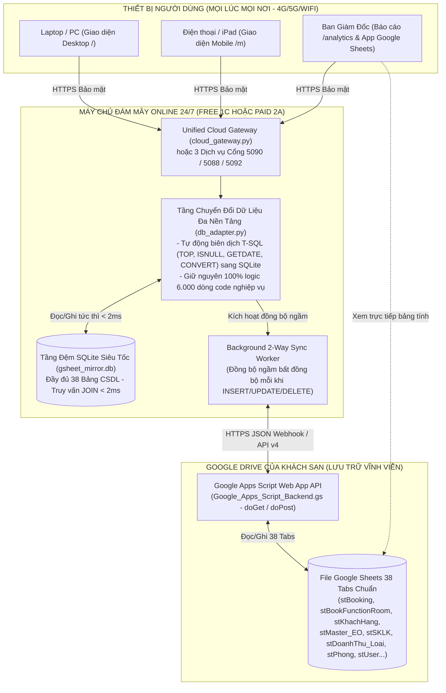

# KẾ HOẠCH CHI TIẾT & PHÂN TÍCH KIẾN TRÚC KỸ THUẬT TOÀN DIỆN (PHIÊN BẢN CẬP NHẬT 3.0)
## PHÂN HỆ AI LẬP TRÌNH TỰ ĐỘNG (CỔNG 8092/5092), BỘ CÀI ĐẶT ĐỘC LẬP TRỌN GÓI & KIẾN TRÚC TRIỂN KHAI ONLINE 24/7 QUA GOOGLE SHEETS (MIỄN PHÍ FREE 1C & TRẢ PHÍ PAID 2A)

> **BẢN THIẾT KẾ KIẾN TRÚC & ĐỀ ÁN KỸ THUẬT CHUẨN XÁC (VERSION 3.0 - FULL CLOUD & PORTABLE)**  
> *Dự án: Hệ thống Quản Lý & Điều Phối Tiệc Cưới - Sự Kiện EMS Banquet (MerPerle / Khải Vy Hotel)*  
> *Cập nhật toàn diện ngày 21/11/2026: Tích hợp toàn bộ các tính năng nghiệp vụ mới nhất (Đặt tiệc đa sảnh BOOK-05, CRM 4 nhóm chiến lược & Validation tự động MST/SĐT CRM-02/03, Quản trị User & Phân quyền 20 danh mục Items USER-01/ITEMS-08, Web Mobile `/m` MOB-01, Dải cổng an toàn 5xxx & Port Manager), đồng thời bổ sung Kiến trúc Triển khai Online 24/7 qua Google Sheets (38 Bảng CSDL) không cần dùng máy tính cá nhân làm Server theo 2 phương án đã phê duyệt: **Miễn phí Free 1C** và **Trả phí Paid 2A**.*

---

## MỤC LỤC TỔNG QUAN

1. [Tổng Hợp Toàn Bộ Các Thay Đổi & Tính Năng Mới Đã Đồng Bộ Vào Bộ Cài v3.0](#1-tổng-hợp-toàn-bộ-các-thay-đổi--tính-năng-mới-đã-đồng-bộ-vào-bộ-cài-v30)
2. [Phân Hệ AI Lập Trình & Sửa Tính Năng Trực Tiếp Trên Web (Cổng 5092 / 8092)](#2-phân-hệ-ai-lập-trình--sửa-tính-năng-trực-tiếp-trên-web-cổng-5092--8092)
3. [Kiến Trúc Bộ Cài Đặt Portable Độc Lập & Cơ Chế Chống Trùng Cổng 5xxx](#3-kiến-trúc-bộ-cài-đặt-portable-độc-lập--cơ-chế-chống-trùng-cổng-5xxx)
4. [Kiến Trúc Cốt Lõi: Hybrid Database Adapter (`db_adapter.py`) & 38 Bảng Google Sheets](#4-kiến-trúc-cốt-lõi-hybrid-database-adapter-db_adapterpy--38-bảng-google-sheets)
5. [Phương Án Triển Khai Online 1 (FREE 1C): Hệ Sinh Thái Google Cloud Run + Apps Script + Cloudflare (0đ/Tháng)](#5-phương-án-triển-khai-online-1-free-1c-100-hệ-sinh-thái-google--cloudflare---0đtháng)
6. [Phương Án Triển Khai Online 2 (PAID 2A): Cloud VPS Việt Nam 24/7 + Cloudflare Zero-Trust HTTPS Tunnel](#6-phương-án-triển-khai-online-2-paid-2a-cloud-vps-việt-nam-247--cloudflare-https-tunnel)
7. [Cấu Trúc Thư Mục Bộ Cài Đặt & Các File Triển Khai Đóng Gói Sẵn](#7-cấu-trúc-thư-mục-bộ-cài-đặt--các-file-triển-khai-đóng-gói-sẵn)

---

## 1. TỔNG HỢP TOÀN BỘ CÁC THAY ĐỔI & TÍNH NĂNG MỚI ĐÃ ĐỒNG BỘ VÀO BỘ CÀI V3.0

Toàn bộ các nâng cấp mới nhất trên hệ thống Production đã được đồng bộ 100% vào gói cài đặt `EMS_Banquet_Portable_Bundle`:

| Mã Hạng Mục | Tên Tính Năng / Thay Đổi | Chi Tiết Kỹ Thuật Đã Triển Khai & Đồng Bộ | Trạng Thái |
| :--- | :--- | :--- | :---: |
| **BOOK-05** | **Đặt Tiệc Đa Sảnh (Multi-Room Booking)** | Cho phép chọn nhiều sảnh tiệc cho cùng 1 đoàn trong 1 lần tạo đơn (1 bản ghi `stBooking`, $N$ bản ghi `stBookFunctionRoom`), kiểm tra xung đột khung giờ độc lập từng sảnh, tích hợp tại Header, Lịch sảnh, Sảnh tiệc và CRM. | **ĐÃ HOÀN THÀNH 100%** |
| **CRM-02** | **Phân Nhóm Chiến Lược 4 Nhóm CRM** | Tự động phân loại toàn bộ khách hàng vào 4 nhóm: **TA (Lữ hành), CORP (Doanh nghiệp), PARTY (Tiệc lẻ), WEDDING (Tiệc cưới)** kèm lối tắt Tạo mới & Sửa chuẩn Form gốc `A. GUEST INFO`. | **ĐÃ HOÀN THÀNH 100%** |
| **CRM-03** | **Tự Động Nhận Diện Đối Tượng & Bắt Buộc MST/SĐT + Chuẩn Hóa Đóng/Mở Modal** | Tự động phát hiện nhóm khách hàng theo thời gian thực khi chọn Nguồn/Phân khúc: bắt buộc nhập **Mã Số Thuế (`*`)** với nhóm **TA** và bắt buộc nhập **Số Điện Thoại (`*`)** với nhóm **CORP / PARTY / WEDDING**. Sửa triệt để lỗi inline style `display: none` giúp đóng/mở mọi Modal liên tiếp không cần F5 refresh. | **ĐÃ HOÀN THÀNH 100%** |
| **USER-01** | **Quản Trị Người Dùng & Quyền Admin Tối Cao** | Quản lý tài khoản nhân viên (`adminems` & `NTTL`), khóa tài khoản nhân viên nghỉ việc (bảo toàn lịch sử booking), xóa tài khoản rác 0 booking, tính năng nhân viên tự đổi mật khẩu trên Header. | **ĐÃ HOÀN THÀNH 100%** |
| **ITEMS-08** | **Phân Quyền Chi Tiết 20 Danh Mục Master Items (A - T)** | Cho phép Admin cấp/thu hồi quyền xem và chỉnh sửa từng mục trong 20 danh mục Items cho từng nhân viên độc lập trong SQLite (`user_item_permissions`), hoàn toàn không ảnh hưởng tới Cana Desktop. | **ĐÃ HOÀN THÀNH 100%** |
| **MOB-01** | **Ứng Dụng Web Mobile & Tablet Chuyên Biệt (`/m`)** | Giao diện di động độc lập `mobile.html` với Bottom Navigation 5 tabs (Lịch sảnh, Đơn tiệc, Lệnh BEO, Khách CRM lọc 4 nhóm & đặt tiệc nhanh, Tiện ích). | **ĐÃ HOÀN THÀNH 100%** |
| **AUDIT-03** | **Ghi Nhận Đích Danh Tài Khoản Khi Thêm/Sửa/Xóa Items** | Nâng cấp API `POST/PUT/DELETE /api/items/{item_key}` ghi nhận đầy đủ `user_name` và `user_full_name` của người đang đăng nhập vào Nhật ký thao tác (Audit Trail). | **ĐÃ HOÀN THÀNH 100%** |
| **PORT-5XXX** | **Dải Cổng An Toàn `5xxx` & Công Cụ Quản Lý Cổng Chọn Lọc** | Sử dụng dải cổng mặc định `5090` (Web), `5088` (Analytics), `5092` (AI), `5888` (Wizard) kèm công cụ quét cổng tự động và chọn tắt riêng từng cổng (`manage_ports.py`, `quan_ly_cong.bat`). | **ĐÃ HOÀN THÀNH 100%** |
| **CLOUD-3.0** | **Kiến Trúc Triển Khai Online Qua Google Sheets (Free 1C & Paid 2A)** | Xây dựng `db_adapter.py` (38 bảng CSDL), `cloud_gateway.py`, `Google_Apps_Script_Backend.gs` và bộ script cài đặt Cloud 1-Click giúp chạy Online 24/7 không cần dùng máy tính cá nhân làm Server. | **ĐÃ HOÀN THÀNH 100%** |
| **BRAND-01** | **Cài Đặt Thương Hiệu & Tùy Biến Logo (White-Label)** | Thay đổi tên khách sạn, slogan, hotline, địa chỉ tức thì qua `modalBrandingConfig`. Xóa triệt để logo MerPerle cũ hardcode trên 2 mẫu BEO, hỗ trợ upload logo Base64 `<= 2MB` hoặc URL ảnh ngoài với khung preview và nút xóa logo. | **ĐÃ HOÀN THÀNH 100%** |
| **EXCEL-02** | **Xuất Excel Quản Lý Đơn Tiệc Fallback 2 Lớp** | Bổ sung `xlsxwriter` vào container Cloud kèm cơ chế tự động fallback sang `openpyxl`, xuất báo cáo 17 cột và 4 KPI Dashboard mượt mà. | **ĐÃ HOÀN THÀNH 100%** |
| **GATEWAY-02**| **Tối Ưu Định Tuyến Cloud Gateway & Sub-Apps** | Ưu tiên Mount sub-apps `/analytics`, `/ai`, `/setup` trước catch-all static, tích hợp redirect 307 an toàn `/analytics -> /analytics/` và `/ai -> /ai/`, chuẩn hóa tiền tố `API_BASE` cho toàn bộ SPA. | **ĐÃ HOÀN THÀNH 100%** |
| **AI-8092** | **Đồng Bộ Phân Hệ AI Coding Agent Lên Cổng 8092** | Đồng bộ mã nguồn chuẩn `ems-ai` ra thư mục gốc, cấu hình cổng 8092, chuẩn hóa `run_ai.bat`, cập nhật `sync_and_restart.py` và kịch bản Windows Service `EMS_Banquet_AI` trên server 10.17.10.12. | **ĐÃ HOÀN THÀNH 100%** |

---

## 2. PHÂN HỆ AI LẬP TRÌNH & SỬA TÍNH NĂNG TRỰC TIẾP TRÊN WEB (CỔNG 5092 / 8092)

Cổng `5092` (hoặc `/ai` khi chạy trên Cloud Gateway) là **Kỹ sư AI Lập trình viên Trực tuyến (In-Browser AI Developer & Coding Agent)**:
1. **Bảo mật Master Gateway**: Bảo vệ bằng mật khẩu quản trị tối cao (`Admin@EMS2026` / `LuanTam@233267`).
2. **Trình So Sánh Code Trước/Sau (Side-by-side Diff Preview)**: Hiển thị rõ dòng thêm mới (màu xanh) và dòng xóa/thay thế (màu đỏ) trước khi áp dụng.
3. **Kiểm Tra Cú Pháp Tự Động (`ast.parse` & JSON check)**: Chặn tuyệt đối việc lưu code lỗi cú pháp gây sập hệ thống.
4. **Tự Động Sao Lưu Snapshot & 1-Click Rollback**: Tự động lưu bản sao dự phòng vào `.ai_snapshots/` trước mỗi lần sửa và cho phép khôi phục lại trạng thái cũ chỉ với 1 cú nhấp chuột trong 2 giây.

---

## 3. KIẾN TRÚC BỘ CÀI ĐẶT PORTABLE ĐỘC LẬP & CƠ CHẾ CHỐNG TRÙNG CỔNG 5XXX

* **Zero-Config Python Runtime**: Nhúng sẵn `python_runtime/` (Python 3.12 64-bit cùng đầy đủ `fastapi`, `uvicorn`, `pyodbc`, `openpyxl`, `pandas`, `gspread`...).
* **Khởi Động Ngầm 100% Không Hiện CMD**: Sử dụng `start_silent.vbs` hoặc đăng ký Windows Services tự động chạy cùng hệ điều hành qua `install_windows_services.bat` (`tools\nssm.exe`).
* **Bộ Tài Nguyên CSDL Đóng Gói Sẵn (`database_templates/`)**:
  * `01_sql_schema_full.sql`: Toàn bộ 77 bảng DDL, 20 Views, 33 Functions, 90 Stored Procedures.
  * `02_sql_master_data.sql`: Dữ liệu danh mục chuẩn 20 nhóm A-T, Sảnh, Phân khúc, Tài khoản & Phân quyền.
  * `03_sql_sample_bookings.sql`: 5 Đơn tiệc & BEO mẫu kiểm thử.
  * `04_google_sheet_template.json` & `04_EMS_Banquet_GoogleSheet_Master_Data.xlsx`: Bộ mẫu **38 Bảng (38 Tabs Excel/Google Sheets)** chứa trọn vẹn cấu trúc và Master Data để đưa lên Google Drive trong 1 phút.

---

## 4. KIẾN TRÚC CỐT LÕI: HYBRID DATABASE ADAPTER (`db_adapter.py`) & 38 BẢNG GOOGLE SHEETS

Để giải quyết triệt để bài toán **chạy hệ thống Online 24/7 với Google Sheets làm Database mà không cần cài SQL Server và không cần dùng máy tính cá nhân làm Server**, hệ thống sử dụng kiến trúc **Hybrid SQLite-to-Google-Sheets Bridge (`db_adapter.py`)**:



### Ưu điểm đột phá của kiến trúc `db_adapter.py`:
1. **Tốc độ phản hồi tức thì ($< 2\text{ms}$)**: Mọi thao tác lọc Lịch sảnh, tìm kiếm 800 khách hàng CRM, tổng hợp biểu đồ doanh thu Analytics được thực thi trên tầng đệm `gsheet_mirror.db` với đầy đủ phép `LEFT JOIN` phức tạp mà không bị nghẽn bởi giới hạn quota hay độ trễ mạng của Google Sheets API.
2. **An toàn dữ liệu tuyệt đối trên Google Drive**: Ngay khi nhân viên bấm Lưu đơn tiệc, Lưu BEO hoặc Tạo khách hàng mới, Worker chạy ngầm sẽ đẩy toàn bộ bảng dữ liệu cập nhật lên đúng Tab tương ứng trong **38 Tabs của Google Sheets** thông qua **Google Apps Script Webhook (`Google_Apps_Script_Backend.gs`)** hoặc **Service Account (`gspread`)**.
3. **Chuyển đổi linh hoạt 100%**: Chỉ cần đổi `"mode": "sql_server"` hoặc `"mode": "google_sheets"` trong `config.json` (hoặc trên Setup Wizard), hệ thống lập tức chuyển đổi mượt mà giữa SQL Server và Google Sheets.

---

## 5. PHƯƠNG ÁN TRIỂN KHAI ONLINE 1 (FREE 1C): 100% ONLINE MIỄN PHÍ — 0Đ/THÁNG (RENDER.COM HOẶC GOOGLE CLOUD RUN)

* **Mục tiêu**: Vận hành hoàn toàn miễn phí (`0đ/tháng`), không cần bật máy tính cá nhân làm server, sử dụng hạ tầng Cloud kết nối trực tiếp với Google Sheets 38 bảng.
* **Lựa chọn Free 1C-1 (Khuyên dùng số 1 — Render.com)**:
  * **100% Miễn phí, TUYỆT ĐỐI KHÔNG CẦN THẺ VISA / MASTERCARD**.
  * Đăng ký bằng Gmail 1 chạm, tự động build Docker container từ `Dockerfile` và cấp link HTTPS vĩnh viễn: `https://ems-banquet-xxxx.onrender.com`.
  * Bộ công cụ hỗ trợ tại: `EMS_Banquet_Portable_Bundle/cloud_deploy/free_1c_render_cloud/push_to_github_for_render.bat`.
* **Lựa chọn Free 1C-2 (Google Cloud Run)**:
  * Miễn phí 2 triệu requests/tháng. Yêu cầu liên kết tài khoản Billing có thẻ Visa/Mastercard (số dư tối thiểu 50k để xác thực tài khoản).
  * Hỗ trợ triển khai 1-chạm qua Google Cloud Shell trên web (`deploy_cloud_shell.sh`) hoặc từ máy tính qua `deploy_google_cloud_run_free.bat`.
* **Thành phần kiến trúc Database**:
  * **Google Sheets** (38 Tabs chuẩn nạp từ `04_EMS_Banquet_GoogleSheet_Master_Data.xlsx`) + **Google Apps Script Web App (`Google_Apps_Script_Backend.gs`)** làm cổng đồng bộ dữ liệu 2 chiều miễn phí trọn đời (kiểm tra tức thì qua `?action=status`).

---

## 6. PHƯƠNG ÁN TRIỂN KHAI ONLINE 2 (PAID 2A): CLOUD VPS VIỆT NAM 24/7 + CLOUDFLARE HTTPS TUNNEL

* **Mục tiêu**: Giải pháp thương mại chuyên nghiệp, ổn định tuyệt đối 24/7 (Always-On 100%, không bao giờ cold-start), tốc độ siêu nhanh tại Việt Nam (`5ms - 15ms`), chi phí tối ưu nhất.
* **Chi phí đầu tư**: Chỉ từ **120.000đ – 250.000đ / tháng** (~$5 - $10/tháng) cho 1 Cloud VPS tại **Viettel IDC, FPT Cloud, AZDIGI, Nhân Hòa** hoặc **Vultr Singapore**.
* **Thành phần kiến trúc**:
  1. **Hạ tầng Máy chủ Cloud VPS**:
     * **Lựa chọn 2A-1 (Cloud VPS Windows Server)**: Chạy trực tiếp gói `EMS_Banquet_Portable_Bundle` với 3 dịch vụ Windows Services chạy ngầm vĩnh viễn qua NSSM (`5090`, `5088`, `5092`). Hỗ trợ chạy **Pure Google Sheets** hoặc **SQL Server Express + Đồng bộ Google Sheets**.
     * **Lựa chọn 2A-2 (Cloud VPS Linux Ubuntu Docker - Tiết kiệm 40% chi phí)**: Chạy qua `docker-compose.yml` với cơ chế `restart: always`.
  2. **Bảo mật Tên miền Riêng HTTPS**: Tích hợp **Cloudflare Zero-Trust Tunnel (`cloudflared`)** giúp gắn tên miền riêng của khách sạn (ví dụ `https://ems.merperle.vn`) với chứng chỉ SSL khóa xanh tự động, chống tấn công DDoS và không cần mở port IP công cộng trên VPS.
* **Bộ công cụ cài đặt đã chuẩn bị sẵn tại**:  
  📁 `EMS_Banquet_Portable_Bundle/cloud_deploy/paid_2a_cloud_vps/`
  * `install_vps_windows_1click.bat`: Script cài đặt tự động 1-Click trên VPS Windows (mở Firewall, đăng ký NSSM Services, bật Setup Wizard).
  * `setup_cloudflare_https_tunnel.bat`: Script tự động tải và cài đặt dịch vụ Cloudflare HTTPS Tunnel.
  * `docker-compose.yml` & `install_vps_ubuntu_docker.sh`: Bộ cài đặt tự động 1-Click trên VPS Linux Ubuntu.

---

## 7. CẤU TRÚC THƯ MỤC BỘ CÀI ĐẶT & CÁC FILE TRIỂN KHAI ĐÓNG GÓI SẴN

```text
EMS_Banquet_Portable_Bundle/
├── EMS_Setup_Wizard.bat                        # [1-CLICK] Mở Trình cài đặt Web Setup Wizard (Cổng 5888)
├── start_system.bat                            # Khởi động cả 3 phân hệ (5090, 5088, 5092)
├── start_silent.vbs                            # Khởi động ngầm 100% không hiện cửa sổ CMD
├── stop_system.bat                             # Dừng hệ thống an toàn
├── force_kill_ports.bat                        # Giải phóng triệt để các cổng 5xxx
├── quan_ly_cong.bat & manage_ports.py          # Công cụ quét & chọn tắt riêng từng cổng đang chạy
├── install_windows_services.bat                # Đăng ký 3 Windows Services chạy ngầm 24/7 qua NSSM
├── uninstall_windows_services.bat              # Gỡ bỏ Windows Services
├── cloud_gateway.py                            # [MỚI v3.0] Cổng hợp nhất đa phân hệ cho Cloud Online
├── Dockerfile & requirements.txt               # [MỚI v3.0] Cấu hình đóng gói Container Cloud
├── config.json                                 # File cấu hình trung tâm (SQL Server / Google Sheets)
├── HUONG_DAN_CAI_DAT_VA_VAN_HANH.md            # Hướng dẫn vận hành tổng thể
├── HUONG_DAN_CAI_DAT_ONLINE_GOOGLE_SHEET_FREE_1C_VA_PAID_2A.md # [MỚI v3.0] Hướng dẫn chi tiết từng bước Free 1C & Paid 2A
│
├── cloud_deploy/                               # [MỚI v3.0] BỘ CÔNG CỤ TRIỂN KHAI CLOUD ONLINE 1-CLICK
│   ├── free_1c_google_ecosystem/               # Phương án Miễn phí Free 1C (Google Cloud + Apps Script + Cloudflare)
│   │   ├── Google_Apps_Script_Backend.gs       # Mã nguồn Apps Script gắn vào Google Sheets (38 Tabs)
│   │   ├── deploy_google_cloud_run_free.bat    # Script deploy 1-Click lên Google Cloud Run Free Tier
│   │   └── deploy_cloudflare_pages_free.bat    # Script deploy giao diện lên Cloudflare Pages CDN
│   └── paid_2a_cloud_vps/                      # Phương án Trả phí Paid 2A (Cloud VPS 24/7 + HTTPS Tunnel)
│       ├── install_vps_windows_1click.bat      # Cài đặt 1-Click cho Cloud VPS Windows
│       ├── setup_cloudflare_https_tunnel.bat   # Gắn tên miền riêng HTTPS qua Cloudflare Tunnel
│       ├── docker-compose.yml                  # Cấu hình Docker Compose cho VPS Linux
│       └── install_vps_ubuntu_docker.sh        # Cài đặt 1-Click cho Cloud VPS Ubuntu
│
├── database_templates/                         # TÀI NGUYÊN CSDL TRÍCH XUẤT NGUYÊN BẢN
│   ├── 01_sql_schema_full.sql                  # DDL 77 bảng, 20 Views, 33 Functions, 90 Procedures
│   ├── 02_sql_master_data.sql                  # Danh mục chuẩn 20 nhóm A-T, Sảnh, User, Phân quyền
│   ├── 03_sql_sample_bookings.sql              # 5 Đơn tiệc & BEO mẫu
│   ├── 04_google_sheet_template.json           # Schema 38 bảng hoàn chỉnh cho Pure Google Sheets
│   └── 04_EMS_Banquet_GoogleSheet_Master_Data.xlsx # File Excel 38 Tabs nạp sẵn Master Data để đưa lên Google Drive
│
├── ems-web/                                    # Phân hệ Web Chính (5090 / 8090) & Mobile (/m)
│   ├── app.py                                  # Đã đồng bộ đầy đủ BOOK-05, CRM-02/03, USER-01, ITEMS-08, MOB-01
│   ├── db_adapter.py                           # [MỚI v3.0] Engine chuyển đổi tự động SQL Server <-> Google Sheets
│   └── static/ (index.html, mobile.html)
│
├── ems-analytics/                              # Phân hệ Báo cáo & Phân tích (5088 / 8088)
│   ├── app.py & db_adapter.py
│   └── static/index.html
│
├── ems-ai/                                     # Phân hệ AI Coding Agent (5092 / 8092)
│   ├── app.py & ai_coder_engine.py
│   └── static/index.html
│
└── setup_wizard/                               # Trình cài đặt Web Setup Wizard (5888)
    ├── wizard_app.py                           # Hỗ trợ tải file mẫu 38 bảng & cấu hình Google Webhook URL
    └── static/index.html
```
