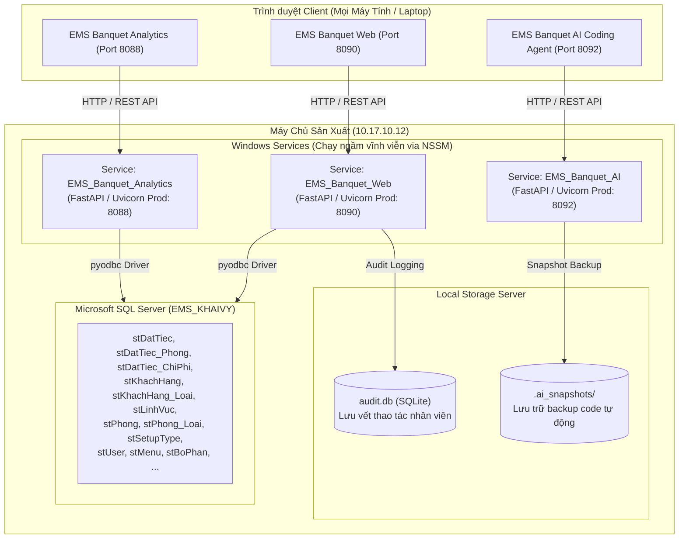

# MASTER PROJECT CONTEXT: EMS BANQUET SYSTEM (DESKTOP TO WEB)

> **BỘ NHỚ TRUNG TÂM CỦA HỆ THỐNG QUẢN LÝ TIỆC MERPERLE / KHẢI VY HOTEL**  
> *Phiên bản tài liệu: 2.0 (Verified & Technical Lead Audited)*  
> *Thời điểm kiểm định: 11/11/2026*  
> *Lưu ý sống còn: Mọi AI Agent và Kỹ sư phần mềm trước khi đọc hoặc sửa code BẮT BUỘC phải đọc kỹ tài liệu này.*

---

## 1. TỔNG QUAN DỰ ÁN VÀ NGUỒN GỐC

### 1.1. Dự án là gì?
Dự án là hệ thống phần mềm nghiệp vụ chuyên sâu phục vụ công tác **kinh doanh, điều phối sảnh tiệc, lập lệnh sự kiện (BEO - Banquet Event Order) và phân tích doanh thu tiệc cưới/hội nghị** cho tổ hợp khách sạn & trung tâm hội nghị **MerPerle / Khải Vy Hotel**.

### 1.2. Nguồn gốc ứng dụng
* **Phần mềm gốc (Legacy Desktop App)**: Ứng dụng Desktop Windows viết trên nền tảng .NET (VB.NET / C#) sử dụng bộ thư viện điều khiển **DevExpress v7.3** (`DevExpress.XtraScheduler`, `DevExpress.XtraGrid`, `DevExpress.XtraBars`, `DevExpress.XtraReports`).
* **Vị trí lưu trữ bản Desktop**: Thư mục `D:\DATTIEC\EMS\` (chứa bộ cài ClickOnce và các thư viện DLL/Forms liên quan).
* **Cơ sở dữ liệu trung tâm**: Microsoft SQL Server (Database: `EMS_KHAIVY` trên máy chủ `10.17.10.12\MSSQLSERVER2016`). Toàn bộ nghiệp vụ, danh bạ khách hàng (hơn 770 khách), lịch sử đơn tiệc, sảnh tiệc, bảng giá, biểu phí, và tài khoản nhân viên lưu trữ trực tiếp trên SQL Server này.

### 1.3. Mục tiêu dài hạn
1. Chuyển đổi (clone & modernize) toàn bộ quy trình nghiệp vụ từ phần mềm Desktop sang nền tảng **Web đa người dùng (Multi-user Web Application)**.
2. Hoạt động trên môi trường mạng nội bộ (máy chủ `10.17.10.12`), cho phép nhân viên kinh doanh, quản lý sảnh, bộ phận BEO và ban giám đốc truy cập trực tiếp qua trình duyệt từ bất kỳ máy tính/laptop nào mà không cần cài đặt phần mềm desktop phức tạp.
3. Kế thừa nguyên vẹn 100% dữ liệu gốc trong CSDL SQL Server `EMS_KHAIVY` mà không làm thay đổi hay phá vỡ cấu trúc bảng của phần mềm desktop cũ đang chạy song song.
4. Tích hợp phân hệ Báo cáo & Phân tích chuyên sâu (EMS Banquet Analytics) phục vụ giám đốc điều hành và kinh doanh.

---

## 2. BẢNG ĐỐI CHIẾU 4 MENU GỐC DESKTOP (`stMenu`) VỚI PHIÊN BẢN WEB

Qua kiểm định trực tiếp từ bảng hệ thống `stMenu` trong CSDL SQL Server `EMS_KHAIVY`, cấu trúc gốc của Desktop gồm đúng 4 Menu chính:

| Mã Menu Desktop | Tên Menu Gốc | Chức năng chi tiết trên Desktop | Hiện trạng trên Web (Port 8090 / 8088) | Mức độ chuyển đổi |
| :--- | :--- | :--- | :--- | :---: |
| **`05`** (`&1.`) | **`mnuInput` (Input Data)** | • `frmCalendar` (Lịch Sảnh Tiệc)<br>• `frmBookingRoom_Date` (Tra cứu tiệc)<br>• `frmMaster_EO` (Soạn & In BEO) | • Lịch Sảnh Tiệc Scheduler gộp ma trận đa ngày<br>• Quản lý & Tra cứu đơn tiệc đa tiêu chí<br>• Lập & In Lệnh BEO chuẩn mẫu Hợp đồng Minh Trí Thành | **HOÀN THÀNH 100%** |
| **`10`** (`&2.`) | **`mnuReports` (Reports)** | • `frmBanquet_Actual`, `frmBanquet_Forecast`<br>• `mnuForecast` (Chiến dịch, sảnh, nguồn khách)<br>• `frmTop_MaxRevenue`, `frmTop_FrequentCustomer`<br>• `frmTurndown_Bussiness`, `frmDsachPhong_notCharges` | • EMS Banquet Analytics (Port 8088): Doanh thu, Phân khúc thị trường, Kênh tiếp thị, Hiệu suất sảnh, In báo cáo<br>*(Các báo cáo chi tiết nhỏ: Phòng miễn phí, Top khách hàng chưa đưa lên)* | **HOÀN THÀNH 85%**<br>*(Phần nghiệp vụ cốt lõi đã hoàn tất)* |
| **`15`** (`&3.`) | **`mnuItems` (Items)** | 20 Danh mục từ A đến T:<br>• Customer (3 menu con: Guest Info, Kind, Segment)<br>• Function Room (3 menu con: Room, Kind, Setup)<br>• 18 Danh mục đơn: C đến T | • Tab 3. Items trên Web 8090<br>• Phân cấp chuẩn A & B có popup menu con kính tối<br>• 18 mục C -> T cân đối lưới 4x5<br>• CRUD động trực tiếp vào SQL Server | **HOÀN THÀNH 100%** |
| **`20`** (`&4.`) | **`mnuUtilities` (Utilities)** | • `frmLogin` (Đăng nhập)<br>• `frmInFoUser` (Thông tin tài khoản)<br>• `frmChangePw` (Đổi mật khẩu)<br>• `frmUserGroup`, `frmRightAccess` (Phân quyền) | • Đăng nhập thủ công qua CSDL `stUser`<br>• Header hiển thị Avatar & Thông tin User<br>• Phân quyền xem Audit Log cho tài khoản Admin<br>• Quản trị Người dùng & Phân quyền Admin tối cao (`adminems` & `NTTL`)<br>• Khóa tài khoản nhân viên nghỉ việc (bảo toàn lịch sử booking & Cana) & Xóa tài khoản rác<br>• User tự đổi mật khẩu cá nhân trên Header | **HOÀN THÀNH 90%** |
| **`25`** (`&5.`) | **CRM Khách Hàng (4 Nhóm Chiến Lược)** | • Quản lý Danh bạ Khách hàng (stKhachHang)<br>• Phân khúc thị trường (stLinhVuc)<br>• Kênh tiếp thị (stKhachHang_Loai) | • Tự động phân loại 795 khách vào 4 nhóm: **TA**, **CORP**, **PARTY**, **WEDDING**<br>• Tab/Pills lọc nhanh kèm Badge số lượng động<br>• Nút `[+ Thêm Khách Hàng]` & Modal tạo khách chuẩn Cana Desktop (`POST /api/customers`)<br>• Nút `[Sửa]` & Modal điều chỉnh thông tin an toàn (`PUT /api/customers/{id}`)<br>• Tinh giản thanh Menu Sidebar (ẩn Phân Khúc & Kênh Tiếp Thị) | **HOÀN THÀNH 100%** |

---

## 3. KIẾN TRÚC KỸ THUẬT HIỆN TẠI



---

## 4. CÔNG NGHỆ ĐANG SỬ DỤNG

| Thành phần | Công nghệ / Thư viện | Vai trò |
| :--- | :--- | :--- |
| **Backend Framework** | Python 3.12 + FastAPI | Xây dựng RESTful API tốc độ cao, xử lý dữ liệu bất đồng bộ |
| **ASGI Web Server** | Uvicorn (Production mode) | Web server hiệu năng cao phục vụ kết nối mạng |
| **Database Connector** | `pyodbc` (ODBC Driver for SQL Server) | Kết nối an toàn đến MS SQL Server `EMS_KHAIVY` |
| **Audit Database** | SQLite 3 (`data/audit.db`) | Ghi nhận lịch sử thao tác, độc lập, không làm biến đổi CSDL gốc |
| **Frontend UI** | HTML5, Tailwind CSS, Lucide Icons | Giao diện hiện đại, responsive, tone màu Navy/Gold sang trọng |
| **Dịch vụ Hệ thống** | NSSM (Non-Sucking Service Manager) | Biến ứng dụng Python thành Windows Services tự chạy cùng OS |
| **Công cụ Đồng bộ** | Robocopy + Python Sync Script | Đồng bộ mã nguồn từ thư mục dev sang server không gián đoạn |
| **Kiểm thử Tự động** | Playwright (Chromium headless) | Kiểm thử E2E tự động, chụp ảnh xác minh thực tế |

---

## 5. CẤU TRÚC THƯ MỤC DỰ ÁN

```
D:\DATTIEC\
├── EMS\                               # Bộ cài và mã nhị phân phần mềm Desktop gốc (.NET DevExpress)
│   ├── Publish\EMS_2_0_0_0\          # File EXE, DLL, config của Desktop EMS
│   └── Update20231215\               # Bản cập nhật desktop
├── ems-web\                           # Phân hệ Web chính (Quản lý tiệc, Lịch, BEO, Items, Audit) - Cổng 8090
│   ├── app.py                         # Backend API chính (FastAPI, SQL schemas, CRUD, BEO logic)
│   ├── data\                          # Thư mục dữ liệu cục bộ
│   │   └── audit.db                   # Database SQLite lưu vết audit trail
│   └── static\
│       └── index.html                 # Giao diện Single Page Application (SPA) của EMS Web
├── ems-analytics\                     # Phân hệ Báo cáo & Phân tích dữ liệu tiệc - Cổng 8088
│   ├── app.py                         # Backend API thống kê doanh thu, phân khúc, sảnh
│   └── static\
│       └── index.html                 # Giao diện báo cáo phân tích, biểu đồ và xuất in
├── ems-ai\                            # Phân hệ AI Coding Agent & Quản trị Code - Cổng 8092
│   ├── app.py                         # Backend API: Master Pass, AI Chat, Config, Test, Diff, Apply, Rollback
│   ├── ai_coder_engine.py             # Multi-Provider AI (Gemini, Antigravity, DeepSeek, Claude, Ollama) & AGENTS.md
│   └── static\
│       └── index.html                 # Giao diện AI Studio: Chat trợ lý, Code Editor, Diff, Rollback & Cấu hình AI
├── PROJECT_DOCUMENTATION\             # BỘ TÀI LIỆU KIẾN THỨC TRUNG TÂM (8 tài liệu chuẩn)
├── EMS_Banquet_Portable_Bundle\       # BỘ CÀI ĐẶT ĐỘC LẬP & CLOUD DEPLOY (v3.3)
│   ├── cloud_deploy\                  # Công cụ triển khai Free 1C (Render.com) & Paid 2A (VPS + Cloudflare)
│   ├── database_templates\            # CSDL mẫu 38 bảng chuẩn (.xlsx, .json, .sql)
│   ├── cloud_gateway.py               # Cổng hợp nhất 5 phân hệ trên 1 port duy nhất
│   ├── render.yaml                    # File cấu hình deploy Render.com 0đ (không cần thẻ tín dụng)
│   ├── config.json                    # Cấu hình White-Label tên thương hiệu riêng của người dùng
│   └── HUONG_DAN_CAI_DAT_ONLINE_GOOGLE_SHEET_FREE_1C_VA_PAID_2A.md # Cẩm nang hướng dẫn chi tiết
├── runtime_env\                       # Python virtual environment (nếu có)
├── run_ai.bat                         # Script khởi động nhanh EMS Banquet AI (Port 8092)
├── install_service_ai_8092.bat        # Kịch bản cài đặt Windows Service EMS_Banquet_AI trên server
├── deploy_to_server.bat               # File batch chạy nhanh đồng bộ và khởi động server
├── sync_and_restart.py                # Script tự động đồng bộ mã nguồn sang \\10.17.10.12\emsmdh và restart dịch vụ
├── AGENTS.md                          # Bản hướng dẫn bắt buộc dành cho mọi AI Agent
└── GEMINI.md                          # Bản tham chiếu hướng dẫn dành cho Gemini
```

---

## 6. CÁC NGUYÊN TẮC BẤT BIẾN (BẮT BUỘC TUÂN THỦ)

1. **Tuyệt đối KHÔNG sửa cấu trúc CSDL SQL Server gốc (`EMS_KHAIVY`)**:
   Phần mềm Desktop cũ vẫn có thể được sử dụng song song. Không được tự ý `ALTER TABLE`, `DROP COLUMN`, đổi kiểu dữ liệu hay thêm cột lạ vào các bảng của hệ thống gốc. Mọi dữ liệu phụ trợ mở rộng (như audit log) phải được lưu ở kho lưu trữ riêng (`audit.db`).
2. **Quy tắc tính Doanh Thu**:
   * Tiệc có trạng thái hủy là `'C'` (`fcStatus = 'C'`) **tuyệt đối không được tính vào doanh thu**.
   * Phân biệt rành mạch giữa **Doanh thu tiệc** (`banquet_rev` / `fnDoanhThu_Tiec`) và **Tổng doanh thu** (`total_rev` / `fnDoanhThu_Tong`).
   * Doanh thu được ghi nhận cho nhân viên phụ trách BEO (`fcMaNV_BEO`), không gán nhầm sang người chỉ thao tác khóa tiệc (`fcUserLock`).
3. **Quy tắc Kiểm tra Trùng giờ khi Xếp Lịch Sảnh**:
   Khi tạo mới, sửa hoặc kéo thả đổi sảnh/ngày tiệc, hệ thống bắt buộc phải kiểm tra xung đột khung giờ (`fdTimeIn`, `fdTimeOut`) của cùng sảnh đó. Nếu trùng giờ, phải cảnh báo từ chối và khôi phục về trạng thái cũ, không để đè tiệc.
4. **Màn hình Đăng Nhập thuần thủ công**:
   Chỉ sử dụng 2 ô nhập tay thủ công `Mã nhân viên / Username` và `Mật khẩu`. Tuyệt đối không thêm dropdown chọn nhanh hay datalist gợi ý tài khoản che lấp màn hình.
5. **Cấu trúc Menu Danh Mục (3. Items A - T)**:
   * Phải khớp 100% với danh mục phần mềm gốc:
     * `A. Customer`: gồm đúng 3 menu con `a. Guest Info.`, `b. Kind of Guests`, `c. Market Segmentation`.
     * `B. Function Room`: gồm đúng 3 menu con `a. Function Room`, `b. Kind of Room`, `c. Setup Type`.
     * Các mục từ `C` đến `T`: là các mục đơn, không có menu phụ.
   * `A. Customer` và `B. Function Room` chỉ được chiếm 1 ô lưới tiêu chuẩn; menu con chỉ được xuất hiện dạng Popup khi người dùng ấn vào, không được tự ý phơi bày ra ngoài làm vỡ giao diện.
6. **Màu sắc và Giao diện Thẩm mỹ**:
   Giữ vững tone màu **Luxury Navy & Amber Gold** cao cấp, các thành phần responsive tối ưu cho laptop văn phòng (1366x768).
7. **Quy tắc BEO Nhiều Ngày (Multi-day BEO Architecture & Sub-Order Navigation)**:
   * Một `fcMaster_EO` trong đơn tiệc diễn ra nhiều ngày sẽ gắn liền với nhiều sub-order trong `stSKLK` (`fcOrderNo = f'{master_eo}_{seq:02d}'`), mỗi sub-order đại diện cho 1 ngày sự kiện.
   * Khi xem và in BEO trên Web, hệ thống phải cung cấp thanh điều hướng ngày con (`beoMultiDayBar`) với các tab trực quan `[Ngày 1 (dd/mm/yyyy)] [Ngày 2 (dd/mm/yyyy)]...`.
   * Lịch trình phòng/sảnh `room_schedules` và mẫu in BEO A4 phải được lọc chặt chẽ theo ngày con đang chọn (`target_date`), tuyệt đối không dồn toàn bộ ca của tất cả các ngày vào chung 1 bảng BEO.
   * Khi lưu BEO trên Web, hệ thống tự động đồng bộ đầy đủ các sub-order vào `stSKLK` và ánh xạ từng phòng trong `stRoom_Setup` vào đúng `fcOrderNo` theo `fdDate` của phòng đó. Điều này đảm bảo tính toàn vẹn 100% dữ liệu, giúp cả EMS Web và phần mềm cũ Cana Desktop chuyển đổi, hiển thị và phân bổ sảnh trơn tru qua từng ngày.
8. **Quy tắc Nguồn Doanh Thu & Giờ BEO Thực Tế (Cana BEO Synchronization)**:
   * **Doanh thu tiệc**: Khi đơn tiệc đã được lập BEO (`stMaster_EO`), nguồn dữ liệu biểu phí và doanh thu chuẩn xác nhất lưu tại bảng `stSKLK_DoanhThu`. Hệ thống báo cáo phân tích (`ems-analytics`) bắt buộc phải ưu tiên `stSKLK_DoanhThu`, chỉ fallback về `stBooking_Charges` khi đơn chưa có BEO.
   * **Khung giờ và số khách BEO**: Giờ block sảnh trong `stBookFunctionRoom` là giờ thô Lễ tân/FO giữ sảnh (ví dụ 11:00 - 17:00). Giờ tiệc thực tế và số khách chốt do Banquet/Sales nhập được lưu trong `stRoom_Setup` (ví dụ 10:30 - 15:00, 25 khách). Khi xuất BEO và hiển thị chi tiết tiệc, hệ thống ưu tiên hiển thị giờ và số khách từ `stRoom_Setup`.
9. **Quy tắc Ổn Định Kết Nối Mạng VPN & Ghi Nhận Lỗi Minh Bạch**:
   * Cấu hình Uvicorn giữ kết nối socket TCP (`timeout_keep_alive=60s`, `limit_concurrency=200`) chống đóng kết nối ngầm khi người dùng thao tác qua VPN.
   * Tại Frontend, các thao tác ghi dữ liệu quan trọng như Lưu BEO bắt buộc phải có cơ chế Auto-Retry lần 2 khi gặp sự cố chập chờn mạng và bẫy lỗi tường minh, hiển thị đúng mã lỗi HTTP nếu có thay vì che giấu thông tin.

---

## 7. QUY TRÌNH PHÁT TRIỂN & VẬN HÀNH

Mọi thay đổi mã nguồn phải được thực hiện trên thư mục cục bộ `D:\DATTIEC\`, sau đó đồng bộ lên server `\\10.17.10.12\emsmdh` và kích hoạt lại Windows Services bằng lệnh:
```powershell
python d:\DATTIEC\sync_and_restart.py
```
Sau đó, bắt buộc phải chạy kịch bản kiểm thử tự động (Playwright) để xác minh hệ thống hoạt động ổn định và chụp ảnh chứng minh trước khi bàn giao cho người dùng.
